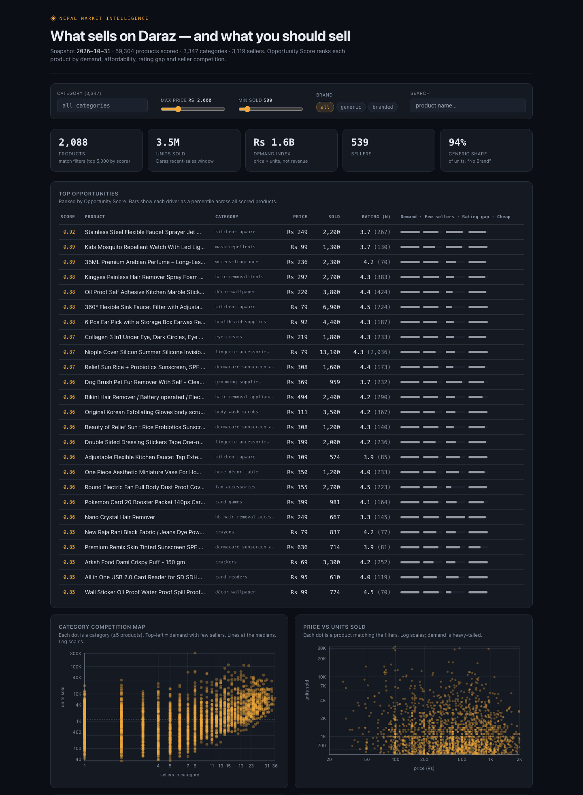

# Daraz Market Analyzer

Scrapes Daraz.com.np category listings to find **what sells** and **how crowded
each category is** — for deciding what products to sell. Data lands in SQLite;
a React dashboard (plus Streamlit and Metabase for internal use) sits on top.



## Project layout

```
daraz/        Scrapy crawler: spider, proxy transport, pipelines, SQLite schema (db.py)
pipeline/     run.py: daily orchestrator (crawl → deepen → audit gate → outputs → retain); audit.py: quality gate
analytics/    analyze.py (Opportunity Score, the only scorer), briefs, reports, weekly watch, review scan
serve/        api.py (FastAPI), app.py (Streamlit), JSON exports, Metabase provisioning, analysis.sql
scripts/      sitemap_categories.py: regenerates the 5,932 category slugs
frontend/     React + TypeScript + Vite + Tailwind + Recharts dashboard
tests/        pytest suite
```

Run everything from the repo root with `python -m <package>.<module>`.

## How it works

- **Scrapy** paginates each category's ajax listing endpoint (`/<slug>/?ajax=true&page=N`,
  ~40 products/page as JSON with price, seller, brand, rating, reviews, `itemSoldCntShow`).
  Categories come from the Daraz sitemap (`daraz/categories_all.py`, 5,932 slugs).
- Requests go through a proxy with one sticky IP per category (Decodo datacenter or liveproxies;
  passwords in macOS Keychain), or through MrScraper or a direct connection, chosen by the `PROXY` env var. The crawler obeys robots.txt.
- Pages are followed only while they still show "X sold" items, up to `MAX_PAGES` and the
  category's real end (`totalResults`). Repeated/stale pages Daraz sometimes serves are detected
  and re-fetched. Every page is logged in `crawl_log`, so a crawl resumes where it stopped.
- Each crawl is one snapshot (`RUN_ID` = start date). Weekly re-crawls of the shortlist give
  velocity (units/week). `analytics/analyze.py` is the single Opportunity Score; `analytics/brief.py` writes
  market-entry briefs; `pipeline/audit.py` checks data quality first.

## Coverage, accuracy, recency

From real runs (October 2026):

| | Number | How it's measured |
|---|---|---|
| Coverage | 4,384 of 4,389 live categories (99.9%); deep run: 16,034 pages, 354,362 distinct products, 131,153 with sales | `crawl_log` per page; "live" = page 1 returns listings |
| Accuracy | price 162/163 (99.4%) and 196/197 (99.5%) match the live site | `audit.py --spot` re-fetches random category pages and diffs the stored rows |
| Recency | daily at 06:00 (launchd) | `pipeline/run.py` quality gate: no more than 5% of page-1 fetches failed, at least 90% of the best live-category count, at least 90% spot-check match |

The gate also blocks bad data. From 2026-10-19 to 2026-10-28 the proxy plan had expired: every
fetch failed, every run was marked failed, and no broken snapshot was scored. The pipeline was
then moved to a second provider (`PROXY=decodo`).

Known limits: Daraz's "X sold" is a rolling recent window, not lifetime sales. About 97% of
listings say "No Brand", and some of those are mislabelled real brands.

## Setup

```bash
uv venv --python 3.12 .venv && uv pip install --python .venv/bin/python -r requirements.txt
cp .env.example .env      # fill DECODO_USER (or LIVEPROXIES_*); no secrets in .env
security add-generic-password -U -s decodo-proxy -a $USER -w   # proxy password
```

## Run

See `CLAUDE.md` → Commands for the full list. Short version:

```bash
.venv/bin/pytest -q
date +%F > .run_id                                   # new snapshot
caffeinate -is env PROXY=decodo RUN_ID=$(cat .run_id) DARAZ_ALL=1 RAW_OFF=1 \
  .venv/bin/scrapy crawl catalog -s CONCURRENT_REQUESTS=16 -s CONCURRENT_REQUESTS_PER_DOMAIN=16 \
  -s DOWNLOAD_DELAY=0 -s AUTOTHROTTLE_ENABLED=False -s DOWNLOAD_TIMEOUT=40   # rerun = resume
.venv/bin/python -m pipeline.audit            # data quality, limitations first
.venv/bin/python -m analytics.brief --write-shortlist   # briefs/index.md + one page per niche
```

## React dashboard (customer-facing) — `frontend/`

Vite + React + TypeScript + Tailwind + Recharts. Polished, pitchable, deployable.
Interactive Opportunity Score, filters, live charts (revenue bar, price-vs-demand
scatter, brand donut, demand gaps).

```bash
python -m serve.export_json                 # data.db -> frontend/src/data.json
cd frontend && npm install
npm run dev                           # http://localhost:5173 (live dev)
npm run build                         # dist/ -> deploy to Cloudflare Pages / Vercel
npm run build:single                  # dist-single/index.html (one self-contained file)
```

Refresh data after a crawl: re-run `python -m serve.export_json`, then rebuild.

**Rebrand for a pitch:** edit `frontend/src/brand.ts` (logo, name, headline) and the
accent hex in `frontend/tailwind.config.js`.

**Deploy to Cloudflare Pages** (custom domain for the client):
```bash
cd frontend
npx wrangler login            # one-time browser auth (your CF account)
npm run deploy                # builds + pushes dist/ to Pages
```
First deploy creates the `daraz-market` project; later `npm run deploy` updates it.
Alternative (no CLI): push the repo to GitHub, connect it in the Cloudflare Pages
dashboard, set build command `npm run build` and output dir `dist`.

### Live data (FastAPI) — optional

By default the React app uses a **bundled** snapshot (`src/data.json`) — works
offline, single-file, and as an Artifact. To have it refresh live from `data.db`
without a rebuild, run the API and point the app at it:

```bash
uvicorn serve.api:app --port 8000            # http://localhost:8000/api/data
# then, in another shell:
cd frontend && VITE_API_URL=http://localhost:8000 npm run dev
```

The header shows a green **● live** badge when connected; otherwise it silently
falls back to the bundled snapshot. `analytics/analyze.py` is the shared scoring module used
by both `serve/export_json.py` (static) and `serve/api.py` (live).

## Analysis app (Streamlit) — internal tool

Interactive Opportunity Score: move sliders (max capital, min units sold,
category, brand, rating, score weights) and watch the ranked "what to sell" list
and charts update live. Reads `data.db` read-only (safe during a crawl).

```bash
python -m streamlit run serve/app.py        # opens http://localhost:8501
```

Opportunity Score comes from `analytics/analyze.py` (demand, velocity, competition, quality gap,
affordability, generic) — the same scorer the CLI, API and briefs use.

## Dashboard (auto-built)

Metabase reads a **snapshot** (`warehouse/dashboard.db`), never the live
`data.db` the crawler writes — reading a mid-write SQLite file reports
"malformed". Refresh the snapshot after each crawl.

```bash
sqlite3 data.db ".backup warehouse/dashboard.db"   # refresh snapshot
sqlite3 warehouse/dashboard.db "PRAGMA journal_mode=DELETE"   # data.db is WAL; Metabase mounts read-only
open -a Docker                                      # start Docker Desktop
docker compose up -d metabase                       # wait ~30s for boot
python -m serve.provision_metabase                        # build the whole dashboard
```

Opens at http://localhost:3000/dashboard/2 (login `admin@daraz.local` /
`Daraz-admin1`). `serve/provision_metabase.py` creates the SQLite connection and all
six panels via the Metabase API — no manual clicking:

- Top products by `est_revenue`
- Best categories by revenue
- Seller concentration per category (few sellers = low competition = opportunity)
- Price vs demand scatter
- Demand gaps: high `sold_count` + low `rating` (do it better)
- Top sellers by revenue

Same queries also in `serve/analysis.sql` — run directly: `sqlite3 data.db < serve/analysis.sql`.

## Config

Edit `daraz/config.py` — `CATEGORY_SLUGS`; env vars `DARAZ_ALL`, `CATEGORIES_FILE`, `MAX_PAGES`, `DARAZ_DB`.

## Notes

- Scope: public category listing pages only. `ROBOTSTXT_OBEY = True`; robots.txt allows the
  `/<slug>/?ajax=true&page=N` listing URLs (checked for all 5,932 slugs) and disallows `/catalog/`
  search, which is never crawled. No personal data is collected (products, prices and seller
  store names only). Low concurrency and per-category sessions keep the load small.
- `.env` and `data.db` are gitignored. Rotate any token that was shared.
